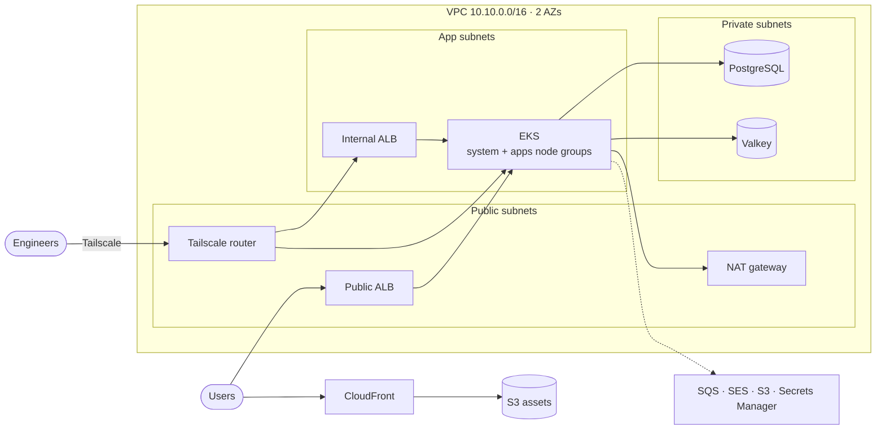

# ShopFlow on AWS EKS

## Overview

Infrastructure for **ShopFlow**, an e-commerce application made of five microservices running on Amazon EKS.
Everything is defined as code with **Terraform modules and Terragrunt**: the network, a private Kubernetes cluster,
managed data services, and the in-cluster platform that delivers and observes the services.

Each environment gets its own AWS account; dev is built and prod is next. The whole stack can be planned
locally, without an AWS account.

## Architecture



**How traffic flows**

- **Static assets:** users → CloudFront (HTTP/3, TLS) → private S3 bucket through Origin Access Control.
- **API requests:** users → public ALB (TLS 1.2+, ACM certificate) → service pods → PostgreSQL and Valkey,
  authenticated with IAM tokens over TLS.
- **Events:** orders and payments publish to SQS; the notifications service consumes them and sends email through SES.
- **Engineers:** Tailscale → subnet router → private EKS API, internal ALB (Argo CD, Grafana) and databases.
  Nothing operational is exposed to the internet.

## Tech stack

| Area | Tools |
|---|---|
| IaC | Terraform 1.13, Terragrunt 0.90, AWS provider 6.38 |
| Compute | EKS 1.34, managed node groups on Graviton (arm64), AL2023 |
| Networking | VPC, ALB, NAT gateway, Route53, CloudFront, ACM, Tailscale |
| Data | RDS PostgreSQL 17, ElastiCache Valkey 8, S3, SQS, SES |
| Security | KMS, Secrets Manager, IAM, EKS Pod Identity, External Secrets |
| Delivery | Argo CD, Argo Rollouts, Helm |
| Observability | Prometheus, Grafana, Loki, Alloy |

## Key features

### Security

- **Private Kubernetes API.** The EKS endpoint has no public access; it is reached over a Tailscale subnet router
  that has no inbound ports.
- **No static credentials.** Every workload uses EKS Pod Identity, trusted only for this account and cluster.
  Node IMDS is limited to hop count 1, so pods can't use the node's credentials.
- **Passwordless databases.** Services connect to PostgreSQL and Valkey with short-lived IAM tokens.
  The RDS master password is generated and stored by RDS.
- **Least privilege per service.** Each microservice gets its own role, database user and resources:

  | Service | PostgreSQL | Valkey keys | S3 | SQS | SES |
  |---|---|---|---|---|---|
  | catalog | ✓ | `catalog:*` | `assets/products/*` | | |
  | users | ✓ | | `data/users/*` | | |
  | orders | ✓ | `orders:*` | | send | |
  | payments | ✓ | | | send | |
  | notifications | | | | consume | send |

- **Encryption at rest.** A customer-managed KMS key per service (EKS secrets, EBS, RDS, ElastiCache, S3, SQS,
  Secrets Manager), rotated every 90 days.
- **Encryption in transit.** TLS 1.2+ on CloudFront and the ALBs (TLS 1.3 policy), `rds.force_ssl`,
  TLS-required Valkey, and bucket and queue policies that deny non-TLS requests.
- **Secrets stay out of Terraform state.** Secrets are created empty, filled outside Terraform, and synced into
  Kubernetes by External Secrets through namespaced SecretStores.
- **MFA-protected cluster access.** IAM groups assume an admin or a read-only role, mapped through EKS access entries.
  The cluster creator gets no implicit admin.

### Networking

- Three subnet tiers across two AZs: **public** (ALB, NAT, router), **app** (nodes and pods, /19 per AZ for
  VPC CNI prefix delegation) and **private** (databases, no internet route).
- Two IngressClasses: **`alb-public`** is internet-facing and only usable from the `apps` namespace;
  **`alb-internal`** serves platform UIs over Tailscale.
- external-dns manages records for each Ingress in the environment's zone.
- An S3 gateway endpoint keeps S3 traffic off the NAT gateway.

### Platform & GitOps

- Platform components are installed by Terraform in two stages: **`helm-core`** (ALB controller, External Secrets,
  Prometheus CRDs, IngressClasses, encrypted gp3 StorageClass), then **`helm-platform`**, which depends on it.
- Argo CD runs an **app of apps** that syncs the microservices from a private GitOps repository, with credentials
  synced from Secrets Manager.
- Argo Rollouts enables canary and blue-green releases.

### Observability

- **Metrics:** kube-prometheus-stack, with Prometheus picking up ServiceMonitors from every namespace.
- **Logs:** Alloy on every node ships container logs to Loki, which runs in simple scalable mode on S3.
- **Dashboards:** Grafana with Prometheus and Loki data sources, admin credentials from Secrets Manager.

### Cost optimization

- Graviton instances everywhere: EKS nodes, RDS, ElastiCache and the Tailscale router.
- Dev runs one NAT gateway and single-AZ data services, with chart resources sized to fit one system node.
- S3 buckets use Bucket Keys, which cuts KMS request costs.

## Project structure

```
.
├── modules/               One Terraform module per AWS service
├── scripts/
│   └── bootstrap.sh       Creates the Terraform state bucket for an environment
└── live/
    └── dev/
        ├── env.hcl        Project, account, region, domain and tags
        ├── root.hcl       S3 backend and AWS provider
        ├── root-helm.hcl  Same, plus the helm and kubectl providers
        └── <unit>/        One Terragrunt unit per stack
```

Each module creates its resources with `for_each` over a map, so the same module serves one resource or many.
Units keep their configuration inline and declare their dependencies, which also sets the apply order.

| Unit | Creates |
|---|---|
| `kms` | One KMS key per service |
| `vpc` | VPC, subnets, route tables, NAT gateway, S3 endpoint |
| `security-groups` | Tailscale router and EKS API security groups |
| `route53`, `acm` | `dev.shopflow.com` hosted zone and wildcard certificate |
| `cloudfront`, `s3` | Assets distribution, assets, data and Loki buckets |
| `sqs`, `ses` | Notifications queue with DLQ, SES domain identity with DKIM |
| `iam-roles` | EKS, node, controller and Tailscale roles |
| `iam-roles-apps` | One Pod Identity role per microservice |
| `iam-groups` | Admins and developers groups |
| `eks` | Cluster, node groups, add-ons, access entries, Pod Identity associations |
| `security-groups-data` | PostgreSQL and Valkey security groups |
| `rds`, `elasticache` | PostgreSQL and Valkey |
| `secrets-manager` | Secrets for the router, Grafana, Argo CD and each microservice |
| `tailscale` | Tailscale subnet router |
| `helm-core` | Controllers, CRDs and cluster-wide objects |
| `helm-platform` | DNS, monitoring, logging and delivery |

## Environments

| | dev | prod (planned) |
|---|---|---|
| NAT gateway | One zonal | Regional |
| RDS and Valkey | Single-AZ | Multi-AZ |
| Node scaling | Managed node groups | On-demand baseline + Karpenter on Spot |
| EKS control plane logs | Off | All log types, 90 days |
| VPC flow logs | Off | On |
| Deletion protection, S3 versioning | Off | On |
| KMS deletion window / secret recovery | 7 / 0 days | 30 / 30 days |
| Prometheus / Loki retention | 7 / 14 days | 15 / 30 days |

## Deployment

### Prerequisites

- Terraform ≥ 1.10, Terragrunt 0.90, AWS CLI v2, kubectl
- An AWS CLI profile per environment (`shopflow-dev`) with MFA
- A Tailscale account

### Create the state bucket (once per environment)

Terraform can't create the bucket that stores its own state, so a script does it: versioned, encrypted,
public access blocked, TLS only. It checks that the profile points at the account in `env.hcl` and is safe to re-run.

```bash
./scripts/bootstrap.sh dev
```

### Plan locally, without AWS

`TG_MOCK=true` switches every unit to local state, fake credentials and mocked dependency outputs:

```bash
cd live/dev
TG_MOCK=true terragrunt run --all plan
```

### Apply

```bash
cd live/dev

# 1. KMS keys and empty secrets
terragrunt run --all apply --queue-include-dir secrets-manager

# 2. Fill in the secrets (Post-deployment, step 1)

# 3. All AWS infrastructure
terragrunt run --all apply --queue-exclude-dir 'helm-*'

# 4. In-cluster platform, from the tailnet (Post-deployment, steps 2 and 3)
aws eks update-kubeconfig --name shopflow-dev --region us-east-1 --profile shopflow-dev \
  --role-arn arn:aws:iam::<account-id>:role/shopflow-dev-eks-admin
terragrunt run --all apply --queue-include-dir 'helm-*' --queue-strict-include
```

## Post-deployment

1. **Secrets.** Set the values before steps 3 and 4:

   | Secret | Value |
   |---|---|
   | `shopflow/dev/tailscale/auth-key` | Reusable, pre-approved Tailscale auth key |
   | `shopflow/dev/grafana/admin` | `{"username": "...", "password": "..."}` |
   | `shopflow/dev/argocd/gitops-repo` | `{"username": "...", "password": "<read-only GitHub token>"}` |
   | `shopflow/dev/<service>/env` | JSON of the service's sensitive environment variables |

   ```bash
   aws secretsmanager put-secret-value --secret-id shopflow/dev/tailscale/auth-key --secret-string '<key>'
   ```

2. **Tailscale.** Approve the advertised `10.10.0.0/16` route for `shopflow-dev-router`, and add the VPC resolver
   `10.10.0.2` as a split-DNS nameserver for `us-east-1.eks.amazonaws.com`, `rds.amazonaws.com`,
   `cache.amazonaws.com` and `dev.shopflow.com`.

3. **Cluster access.** Add your IAM user to `shopflow-dev-admins` (or `shopflow-dev-developers` for read-only).
   The group can assume the matching EKS role, which requires MFA.

4. **Database users.** Connect as the master user (credentials in the RDS-managed secret) and run:

   ```sql
   CREATE USER catalog;  GRANT rds_iam TO catalog;
   CREATE USER users;    GRANT rds_iam TO users;
   CREATE USER orders;   GRANT rds_iam TO orders;
   CREATE USER payments; GRANT rds_iam TO payments;
   ```

5. **Access the platform** (over Tailscale):

   | | URL | Login |
   |---|---|---|
   | Argo CD | https://argocd.dev.shopflow.com | `admin`, password in the `argocd-initial-admin-secret` Secret |
   | Grafana | https://grafana.dev.shopflow.com | From `shopflow/dev/grafana/admin` |

   For the Argo CD CLI: `argocd login argocd.dev.shopflow.com --grpc-web`.

## CI/CD

Planned: a GitHub Actions workflow that runs on every pull request:

- `terraform fmt` and `terragrunt hcl fmt` checks
- `tflint`
- A security scan of the Terraform code
- `TG_MOCK=true terragrunt run --all plan`

Applies will authenticate to AWS through GitHub OIDC, with no long-lived keys.

## Roadmap

- [ ] Prod environment
- [ ] GitHub OIDC deploy role
- [ ] CI pipeline
- [ ] Account baseline: CloudTrail, GuardDuty, AWS Config, AWS Budgets
